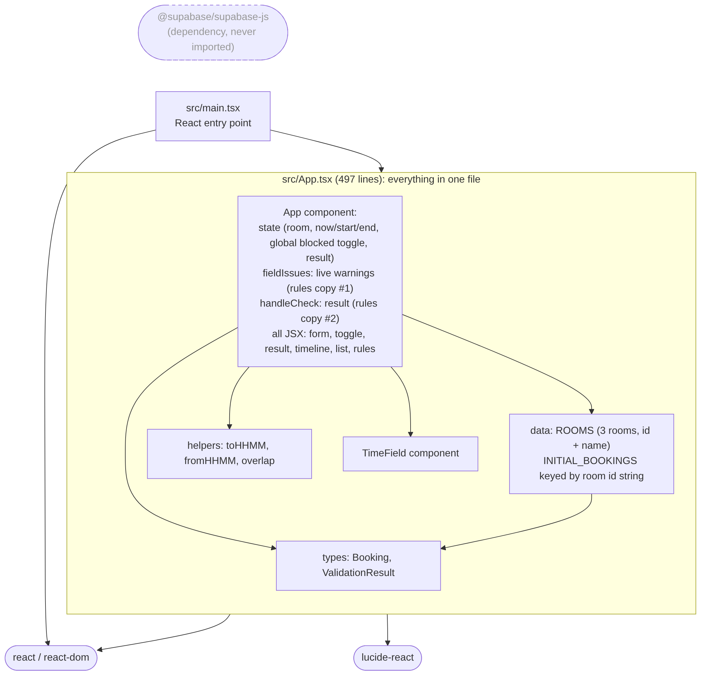
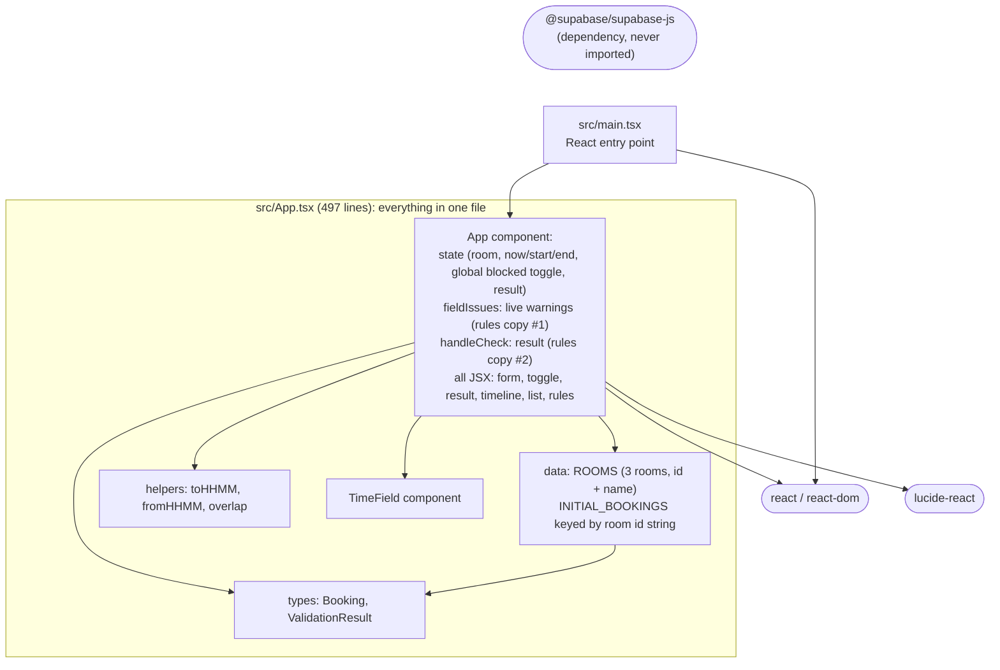
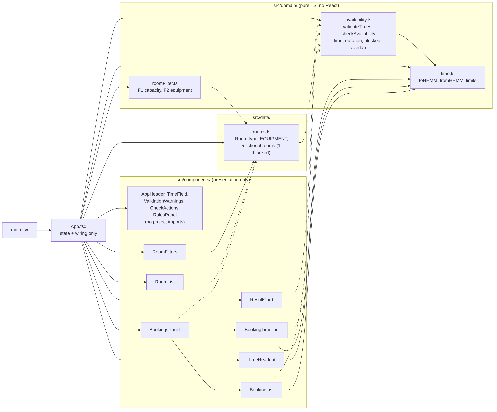
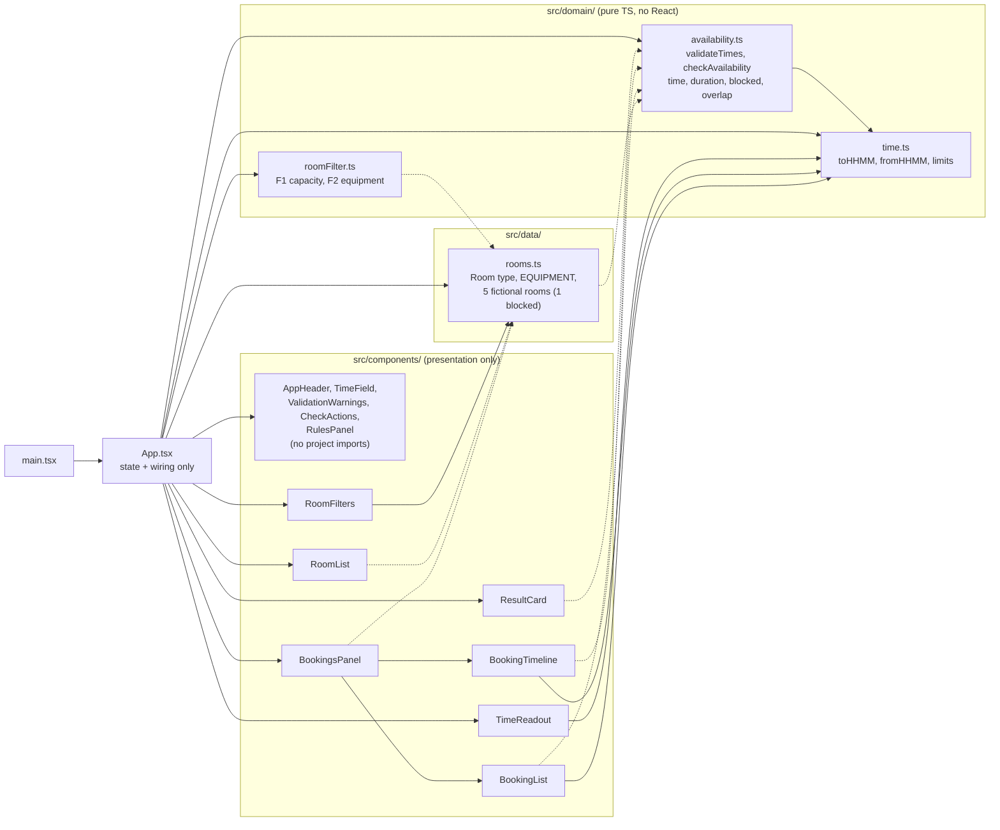

# Evaluation: Smart Campus Room Availability Checker

This compares the original Bolt.new prototype (`d809e10`) with the final version (`1543f39`, the last code commit; this document is committed after it).
Every number below comes from a command, file or commit named in the "How it was measured" column. The raw output of those commands is in [`measurements.txt`](measurements.txt).

Contents:
1. Module diagrams (before / after)
2. Design decisions
3. Quality comparison
4. Commit history
5. Screenshots

---

## 1. Module diagrams

Sources: [`diagrams/before.mmd`](diagrams/before.mmd), [`diagrams/after.mmd`](diagrams/after.mmd). The PNGs were rendered from these sources with `mmdc` (mermaid-cli 11.16.0, headless Chrome).

### Before: `d809e10`





### After: `1543f39`

Solid arrow = value import. Dashed arrow = type-only import (`import type`). The arrows were taken from the actual `import` statements in `src/`. The five components in the top-left box import nothing from the project.





Dependencies point only one way: **components → domain/data**, and **domain → time**. Nothing in `src/domain/` imports React (checked with `grep -rn "react" src/domain` → no matches).

---

## 2. Design decisions

**D1. Write the regression tests on the original code before refactoring.**
The step-1 tests (`3f5b819`) exercise the page the way a user does, on the untouched `App.tsx`. The result was 30/30 ([`test-results/baseline.txt`](../test-results/baseline.txt)). Because they only interact with the page, the same tests could stay unchanged through refactors 2a, 2b and 3a. If they still pass after a refactor, the behaviour was kept. The one known bug, the stale result after editing times, was first recorded as current behaviour and then deliberately flipped in `273f13b`, so the before/after difference is visible in the test history. To check that the tests could actually fail, they were run once against intentionally broken copies of the code (overlap treating touching endpoints as overlapping, rejecting exactly 120 minutes): 7 failed. These were manual one-off checks, reverted with `git checkout`, and are not saved as scripts.

**D2. Pure domain functions, separate from React.**
`src/domain/` contains only plain TypeScript functions with no state and no rendering. This made it possible to test the rules directly: 59 unit tests in `tests/unit/`, which need no rendering. It also made the 2b merge possible. In the original, the same five time rules were written twice: once for the live warnings (L89–100) and once for the Check button (L103–135). Now `validateTimes()` produces both, so the two can no longer disagree.

**D3. Filtering is separate from availability.**
"Does this room fit my needs?" (`roomFilter.ts`: capacity F1, equipment F2) and "Is this room free at this time?" (`availability.ts`: time window, duration, blocked, overlap) answer different questions. `checkAvailability()` takes only times, bookings and a blocked flag; it knows nothing about attendees or equipment. Two benefits follow:
- The filter can never accidentally hide a booking conflict.
- Each module is tested on its own (`roomFilter.test.ts` and `availability.test.ts`).

**D4. Blocked is room data, not a global toggle.**
In the original, `blocked` was a single on/off state (L77) that applied to whichever room was selected and stayed on when switching rooms. F3 requires that a specific room is blocked. `blocked` is now a field on each `Room` in `src/data/rooms.ts`, and `checkAvailability(…, room.blocked)` reads it. The blocked room is deliberately **not** filtered out. It stays in the list with a "Blocked" badge, so F3 is visible in the demo (screenshot e), and the booking rules guarantee it is always Unavailable.

**D5. Clear the result whenever an input changes.**
The original kept an old "Available" on screen after the times were edited. Now any change to Now, Start or End clears the result, as does a room change or a filter change that removes the selected room (`273f13b`, `2cdb696`). We chose clearing over recalculating the result live, so the explicit "Check" step from the original design stays in place.

---

## 3. Quality comparison

| Aspect | Original `d809e10` | Final `1543f39` | How it was measured |
|---|---|---|---|
| Automated tests | None: `npm test` → `Missing script: "test"`, 0 test files | **113 / 113 passed**, 5 files: 59 unit + 54 UI | `npm test` in both checkouts ([`measurements.txt`](measurements.txt)); [`test-results/final.txt`](../test-results/final.txt) |
| Same UI regression suite run against the original | 30 / 30 passed (one test records the stale-result bug as current behaviour) | 33 / 33 passed (bug test flipped, plus 3 per-field cases) | [`test-results/baseline.txt`](../test-results/baseline.txt) at `3f5b819`; `tests/ui/App.regression.test.tsx` in `final.txt` |
| Unit vs UI tests | — | Unit: `availability` 25, `roomFilter` 24, `time` 10. UI: regression 33, features/e2e 21 | Per-file count of `✓` lines in `test-results/final.txt` (bottom of `measurements.txt`) |
| Do the tests catch broken rules? | — | Intentionally broken copies: F1 `>=`→`>`: 4 failed. F2 "all"→"any": 4 failed. Blocked check removed: 7 failed. Step 1: 7 failed. | Manual `sed` edits run against `src/`, reverted with `git checkout -- src` (described in D1; not saved as scripts) |
| Duplicated validation rules | 5 rules written twice: warnings L89–100 (12 lines) and `handleCheck` L103–135 (33 lines), 45 lines in total | 1 implementation, `validateTimes()` in `src/domain/availability.ts`. 4 rules merged; the unreachable "now out of range" rule (L93–94 / L107–110) deleted | `git show d809e10:src/App.tsx \| sed -n '89,100p;103,135p'`; diff of commit `a77bd21` |
| Duplicated default values | Defaults written twice: initial state L73–77 and `handleReset` L161–165 | One `DEFAULTS` object used by both | `grep` in `measurements.txt`; `src/App.tsx` (`DEFAULTS`) |
| Literals 120 / 1439 / 1440 | 22 lines in `App.tsx` | Defined once as `MINUTES_PER_DAY` / `MAX_BOOKING_MINUTES` in `time.ts`. Remaining literals are display text (RulesPanel 2, TimeReadout 1, one message in `availability.ts`) and the 2-hour tick spacing in `BookingTimeline` | `grep -rcE '\b(120\|1439\|1440)\b' src` |
| Source modules and responsibilities | 3 files: `main.tsx`, `vite-env.d.ts`, `App.tsx` (497 lines). `App.tsx` held the types, data, helpers, both validation copies, state, all markup and `TimeField` | 19 files:<br/>• `App.tsx` (160 lines): state and wiring only<br/>• 12 components in `src/components/`: presentation only<br/>• `domain/time.ts`: conversion, limits<br/>• `domain/availability.ts`: time, duration, blocked, overlap<br/>• `domain/roomFilter.ts`: F1, F2<br/>• `data/rooms.ts`: catalog | `find src -name '*.ts*' \| xargs wc -l`; diagrams in §1 |
| Room data | 3 rooms (id + name only). Bookings in a separate map keyed by room id; a missing key silently became `[]` | 5 rooms, each with id, name, capacity, equipment, blocked and its own bookings. 1 blocked; capacities 2–40 | `src/data/rooms.ts`; catalog test in `tests/unit/roomFilter.test.ts` |
| Blocked status | One global toggle that applied to every room | Per-room `blocked` field; toggle removed | `d809e10:src/App.tsx` L77, L258–269; `src/data/rooms.ts` |
| Stale result after editing times | Present: old result stays visible | Fixed: any time edit clears the result | Characterization test at `3f5b819`, flipped at `273f13b` |
| Labels linked to time inputs | No (`<label>` without `htmlFor`); the tests had to find inputs through the wrapper element | Yes (`htmlFor` / `id` via `useId`, hint linked with `aria-describedby`); tests use `getByLabelText` | `src/components/TimeField.tsx`; test helper change in `1688fc5` |
| `npm run build` | Pass. JS 158.59 kB (gzip 50.51), CSS 15.33 kB | Pass. JS 164.97 kB (gzip 52.31), CSS 14.89 kB | `npm run build` ([`measurements.txt`](measurements.txt)) |
| `npm run typecheck` | Pass (exit 0) | Pass (exit 0) | `npm run typecheck` |
| `npm run lint` | Pass (exit 0) | Pass (exit 0) | `npm run lint` |
| `npm audit --omit=dev` (packages that ship with the app) | 1 high: `ws`, pulled in by the unused `@supabase/supabase-js` | 0 vulnerabilities | `npm audit --omit=dev`; `npm ls ws` in the original |
| `npm audit` (including dev tools) | 22 (2 low, 6 moderate, 14 high) | **25 (2 low, 7 moderate, 14 high, 2 critical)**. The new ones come from the test tooling: `vitest` 2.1.9, `@vitest/mocker`, `tinypool` | `npm audit`; `npm audit --json` |
| Page title / meta | "Vite + React + TS"; bolt.new og/twitter images; `/vite.svg` favicon (file missing) | "Smart Campus Room Availability"; description meta; no external URLs | `index.html` in both commits |
| Narrow screen (390 px) | Not measured | No horizontal scroll (`scrollWidth > clientWidth` was `false`); layout in screenshot f. The timeline hour labels overlap (see limitations) | `docs/scripts/screenshots.cjs` (headless Chrome, 390×844); `screenshots/f-mobile-390.png` |

### Remaining limitations

1. **The page can't take an end time of 24:00.** AC1 allows `end = 1440`, and `checkAvailability` accepts it (unit test "accepts end == 1440 at the domain level"). But the page's time input and `fromHHMM` only go up to 23:59, so a booking ending at midnight can't be requested from the page. Documented by decision, not fixed.
2. **Dev-only audit findings from the test tooling.** `vitest` 2.1.9 has 2 critical advisories (GHSA-5xrq-8626-4rwp, GHSA-82fw-gwwq-j7x9; plus `tinypool`). They affect the developer machine running the tests or the Vitest UI server, not the built app (`npm audit --omit=dev`: 0). The fix npm offers is a semver-major upgrade to `vitest` 5.1.0; it was not attempted.
3. **Mobile timeline labels overlap.** At 390 px the 13 hour labels under the timeline run into each other ("00:0002:00…", screenshot f). Short booking names in the timeline are cut off ("Cal", "Pro"), in the original too. The list below the timeline shows the full names.
4. **Time format depends on the browser locale.** `<input type="time">` shows 12-hour AM/PM in the headless Chrome used here (en-US). The result text and timeline use 24-hour `HH:MM`.
5. **"Available" appears twice.** The headline and the reason line both say "Available" (screenshot c). This is unchanged from the original.
6. **Limited test environment.** The UI tests run in jsdom, so they don't check real layout or CSS. The layout was looked at only in headless Chrome via the screenshots. Firefox, Safari and real phones were not tested.
7. **Static data by design.** The catalog is fictional, in-memory and read-only. There is no persistence, login or backend, as the assignment requires.

---

## 4. Commit history

`git log --oneline` (oldest first):

| Commit | Step | What it did |
|---|---|---|
| `d809e10` | 0 | Original Bolt.new export, unmodified (baseline for comparison) |
| `3f5b819` | 1 | Vitest + React Testing Library; 30 UI regression tests on the untouched `App.tsx`; `test-results/baseline.txt` |
| `263c2b8` | 2a | Moved `toHHMM`/`fromHHMM`/constants to `domain/time.ts` and the booking rules to `domain/availability.ts` (`checkAvailability`); no behaviour change |
| `a77bd21` | 2b | One `validateTimes()` for both live warnings and the Check result; 5 duplicated rules → 1 implementation (1 dead rule deleted) |
| `273f13b` | 2c | Editing any time field clears the result; known-bug test flipped; `test-results/after-refactor.txt` (33/33) |
| `f7ed8ec` | 3a | Split the page into 12 presentational components in `src/components/`; same markup (CSS hash unchanged) |
| `2cdb696` | 3b | Room catalog (`data/rooms.ts`), F1/F2 filters (`domain/roomFilter.ts`), filter UI, F4 empty state, per-room blocked (F3), selection clearing (F5); AC3 test moved to the blocked room |
| `1688fc5` | 4 | Housekeeping: removed Supabase, linked labels, real page title, no bolt.new meta, "24:00" timeline label |
| `1543f39` | 4 | Full test suite: 59 unit + 54 UI tests, 113/113; `test-results/final.txt` |
| *(this commit)* | 5 | Evaluation docs: diagrams, comparison, screenshots |

---

## 5. Screenshots

Taken with headless Chrome (Playwright, `/usr/bin/google-chrome`) against `vite preview` of the production build, using [`scripts/screenshots.cjs`](scripts/screenshots.cjs). Desktop shots are 1024 px wide, the mobile one is 390 px. All are full-page at 2× scale.

| | Scenario | File |
|---|---|---|
| a | Filters with several matches: 8 attendees + Projector → 3 rooms, including the blocked studio with its badge | [`a-filters-several-matches.png`](screenshots/a-filters-several-matches.png) |
| b | Empty state: Video conferencing + Computers → "No rooms match your filters" + Clear filters | [`b-empty-state.png`](screenshots/b-empty-state.png) |
| c | Available: Library Study Room 201, 10:30–11:30 | [`c-available.png`](screenshots/c-available.png) |
| d | Unavailable, overlap: Business Seminar Room 305, same slot → conflicts with "Case Discussion" | [`d-unavailable-overlap.png`](screenshots/d-unavailable-overlap.png) |
| e | Blocked room checked: Media Studio 014, free slot 13:00–14:00 → "Room is blocked" | [`e-blocked-room.png`](screenshots/e-blocked-room.png) |
| f | Mobile 390 px: 20 attendees + Projector, Engineering Lab 110, 10:00–12:00 → Available | [`f-mobile-390.png`](screenshots/f-mobile-390.png) |

To reproduce:

```sh
npm run build && npx vite preview --port 4173 --strictPort &
NODE_PATH=<folder containing playwright> CHROME=/usr/bin/google-chrome node docs/scripts/screenshots.cjs
```

Playwright is not a project dependency; it was installed globally in the environment that produced these files.
